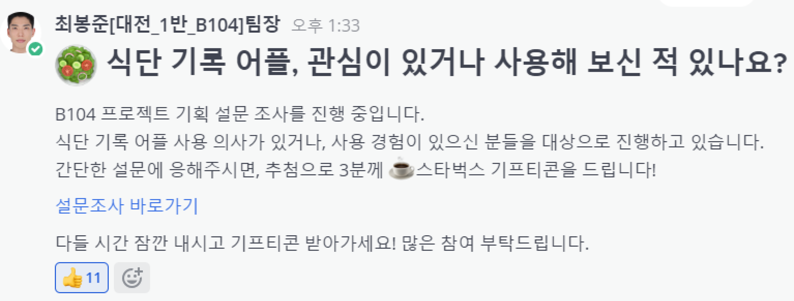
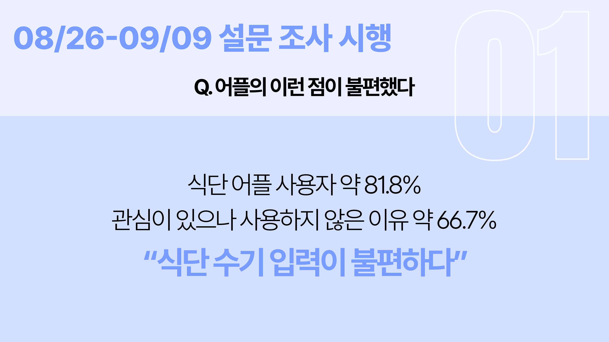
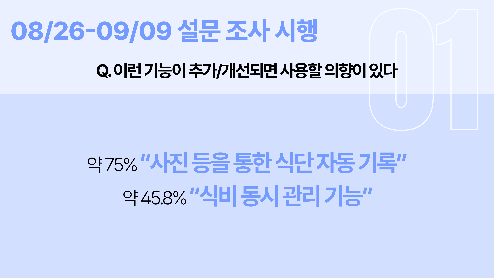

# AllEat : 식단 식비 통합 자동관리 서비스

## 🚩 목차

1. [기획 배경](#기획-배경)
2. [서비스 소개](#서비스-소개)
3. [기능 소개](#기능-소개)
4. [기술 스택](#기술-스택)
5. [프로젝트 일정 및 기타 산출물](#프로젝트-일정-및-기타-산출물)
6. [팀원 소개 및 소감](#팀원-소개-및-소감)

## ✨ 기획 배경

### 개요

- 거래내역을 기반으로 수기로만 작성됐던 일반 식단 및 식비 서비스를 한번에 손쉽게 관리
- 2024 소비트렌드를 보면 자기관리가 열풍 및 건강식단 관심도 증가
- 건강식단을 유지하는 과정에서 식비 관리는 쉽지가 않다는 걸 확인할 수 있다.

### 기존 어플 조사 및 설문조사

0. 설문조사 시행

1. 기존 어플의 이런 점이 불편했다.

2. 이런 기능이 추가/개선되면 사용할 의향이 있다.

### 서비스 목표

- 식단 수기 입력이 불편하다 + 식비 동시 관리 기능이 있으면 좋겠다.
    > **거래내역을 추적하여 사용자 식단 및 식비 기록 자동화**
- 사등을 통한 식단 자동 기록이 있으면 좋겠다.
    > **AI를 통해 사진 분석 및 식단 기록**

## ✨ 서비스 소개

### 페르소나

- 이사로 인해 대량의 물건들을 빠르게 판매하고 싶은 판매자
  - 많은 중고물품을 한번에 팔 수 있는 플랫폼
  - 라이브로 실시간 판매 가능
  - 하나하나 정보를 입력하지 않고 음성인식 및 자동 카테고리 분류로 간단하게 상품정보 등록  

- 대량의 중고물품을 저렴하게 사고 싶은 구매자
  - 라이브로 실시간 거래약속 생성
  - 한명의 판매자와 여러개의 상품 거래
  - 쇼츠로 편하게 상품 열람

### 기대효과

**내 손 안의 작은 홈쇼핑**  
누구나 간편하게 라이브 방송을 통한 상품 판매 가능  
  
**상품 홍보 숏폼**  
자동으로 생성되는 숏폼과 AI 요약본으로 거래가 완료될 때까지 콘텐츠로 상품 홍보 가능  
  
**퍼스널 소통 어시스턴트**  
챗봇 시스템 도입으로 거래자 간의 소통 최소화  
당신만을 위한 일정 관리 비서, 거래 일정 캘린더 자동 생성  

**대량 구매&판매**  
라이브 커머스를 통해 다량의 물품을 한 번에 판매&구매 가능  
  
  

## ✨ 기능 소개

- **메인 페이지 기능**
  - **0CHA가 추천하는 루틴** : 0CHA가 직접 개발하고 고안한 루틴을 추천합니다.
  - **진행 중인 운동** : 현재 진행 중인 운동이 있는 경우 바로 이동할 수 있습니다.
  - **내 루틴** : 내 루틴을 최신 순으로 보여집니다. 더 보기를 누르면 루틴 목록으로 각 루틴의 상세 정보를 누르면 루틴의 상세 정보를 확인할 수 있습니다.
- **회원가입 & 프로필 페이지 기능**
  - **회원가입** : 이메일 인증, 비밀번호, 생년월일, 전화번호, 닉네임 입력 후 가입할 수 있습니다.
  - **로그인 & 로그아웃** : JWT Token을 사용하여 로그인 및 로그아웃이 가능합니다.
  - **소셜 로그인** : Google, Kakao 계정과 연동하여 로그인이 가능합니다.
  - **프로필 수정** : 프로필 이미지와 닉네임을 변경할 수 있습니다.
  - **내 정보 수정** : 내 키와 몸무게 활동 지역을 변경할 수 있습니다.
  - **회원 탈퇴** : 회원 탈퇴 문구 작성 후 탈퇴 가능합니다.
- **운동 페이지 기능**
  - **운동 목록** : 상단의 부위를 탭하여 해당 부위의 운동 목록을 확인할 수 있습니다.
  - **운동 찜** : 사용자는 별표 버튼을 클릭해 운동을 찜/찜해제 할 수 있습니다.
  - **운동 상세보기** : 운동을 클릭해 각 운동의 운동 예시와 운동 상세정보를 확인할 수 있습니다.
  - **루틴에 운동 추가** : 사용자는 V표를 클릭해 루틴에 추가할 운동을 선택할 수 있고 새 루틴에 추가하기 버튼을 클릭해 새 루틴에 운동을 추가할 수 있습니다.
  - **운동 검색** : 검색창에 검색어를 입력하면 해당 부위에 맞는 운동이 실시간으로 검색됩니다.
- **기록 페이지 기능**

  - **달력** : 루틴이 저장된 날은 녹색, 선택된 날은 빨간색, 오늘은 녹색 원이 표시됩니다. 루틴이 없는 날을 선택할 경우 루틴 생성하기 버튼이, 있는 날을 선택할 경우 루틴 확인하기 버튼이 토글됩니다.
  - **인바디 등록** : 사진 혹은 촬영을 통해 인바디 결과지를 등록할 수 있습니다. 등록한 결과지를 토대로 인식하고, 세부정보를 입력할 수 있는 폼을 제공합니다.
  - **인바디 결과** : 본인의 인바디 입력을 항목별로 추이를 확인할 수 있는 그래프를 제공합니다.
  - **운동 기록** : 운동 기록 탭에서 개인 운동량 추이와 총 운동 시간 추이를 확인할 수 있습니다.

- **AI 페이지 기능**
  - **운동 설정** : 운동 설정에서 수행할 운동과 횟수(1~10)를 선택할 수 있습니다. 시작하기 버튼을 누르면 초기 세팅이 완료됩니다.
  - **운동 시작** : 준비 버튼과 이어 카메라 시작 버튼을 누르면 준비 시간 5초 후 운동을 시작합니다.
  - **운동 수행** : 잘못된 자세를 취하는 경우 화면에 X 표시가 정 자세를 취하는 경우 화면에 O 표시가 나타납니다. 운동할 때마다 횟수를 카운트해줍니다. 아래 진행 바를 통해서도 시각적으로 확인할 수 있습니다. 지정 횟수에 도달하면 자동으로 종료됩니다. 운동을 중간에 종료시키고 싶은 경우 운동 종료 버튼을 눌러 운동을 종료할 수 있습니다.
  - **운동 결과** : 운동 종료시 자동으로 운동 결과 모달이 나타납니다. 사용자는 본인이 수행한 자세가 올바른지 아닌지 코멘트를 확인할 수 있습니다.
- **피드 페이지 기능**

  - **피드 보기** : 자신이 팔로우한 유저들의 피드를 최신순으로 확인할 수 있습니다.
  - **피드 작성** : 오늘 운동을 한 경우 피드를 작성할 수 있습니다. 이미지는 반드시 첨부해야 합니다. 내용은 없어도 됩니다.
  - **피드 수정 & 삭제** : 본인이 작성한 피드의 내용과 이미지를 수정 및 삭제할 수 있습니다.
  - **댓글 작성 & 수정 & 삭제** : 사용자들은 피드에 댓글을 작성하고 수정, 삭제할 수 있습니다.
  - **피드 좋아요** : 사용자는 한 피드에 대해 하나의 좋아요/좋아요 취소가 가능합니다.
  - **무한 스크롤** : 피드 목록 하단에 도달할 경우 추가 피드를 탐색해 줍니다.
  - **유저 검색** : 검색창에서 유저 닉네임을 통해 유저를 검색할 수 있습니다.

- **거래 페이지 기능**

  - **상품 보기** : 전체 상품들을 확인할 수 있습니다. 상품은 대표 이미지, 제목, 가격, 판매 상태, 좋아요 개수가 나타납니다.
  - **상품 필터링** : 광역자치단체, 기초자치단체, 검색어를 이용해 해당 조건을 충족하는 상품들을 필터링해 보여줍니다.
  - **상품 좋아요** : 사용자는 하트 버튼을 눌러 좋아요/좋아요 취소가 가능합니다.
  - **상품 상세 모달** : 상세 모달에서는 판매자, 내용이 추가로 표시됩니다.
  - **상품 게시글 작성** : 판매자는 최대 5장 한 장당 5MB 이하의 사진들을 게시할 수 있습니다. 게시 조건은 이미지 한 장 이상, 제목, 가격, 내용 모두 필요합니다.
  - **상품 수정&삭제** : 판매자(글 게시자)는 상품의 수정, 삭제, 판매 상태 변경이 가능합니다. 판매 완료 상태인 경우 수정은 불가합니다.
  - **채팅하기** : 채팅하기를 통해 판매자 또는 구매자와 채팅할 수 있습니다. 판매자가 누른 경우 채팅 목록으로, 구매자가 누른 경우 판매자와의 채팅으로 이동합니다.
  - **페이지네이션** : 사용자는 10개 이상의 게시물이 있는 경우 페이지로 분할된 상품 목록을 확인할 수 있습니다.

- **SNS 프로필 페이지 기능**

  - **SNS 프로필 상단** : SNS 프로필 상단에서는 닉네임 운동, 거래 게시글 수, 팔로잉, 팔로워 수가 나타납니다. 자신의 프로필인 경우 채팅 목록과 내 정보 버튼이, 다른 사람의 프로필인 경우 채팅하기와 프로필 버튼이 나타납니다.
  - **운동/거래 탭** : 해당 유저가 게시한 운동, 거래 게시글의 대표 이미지가 3\*n 형태의 격자로 나타납니다. 운동 게시글을 클릭할 경우 위 아래로 스크롤할 경우 이전 다음 게시글을 확인할 수 있습니다. 거래 게시글을 클릭할 경우 해당 거래 게시글의 상세 모달이 띄워집니다.

- **채팅 기능**
  - **채팅 목록** : 채팅 목록에서는 사용자가 하나 이상의 채팅 이력이 있는 채팅방을 확인할 수 있습니다.
  - **채팅** : 채팅에서는 사용자가 상대방과 채팅 기능을 할 수 있습니다.
  - **챗봇 도우미** : 다량의 물품을 한 번에 판매하는 서비스의 특성 상 판매자에게 너무 많은 채팅방이 생성되는 것을 방지하기 위해, 일부 기능을 자동화하여 챗봇이 사용자의 역할을 대신합니다.
    - 거래 시간 변경 : 구매자는 거래 시간 변경 요청을 보낼 수 있습니다. 판매자는 승인/거절 버튼을 이용해 간단하게 답변할 수 있습니다.
    - 거래 파기 : 거래 파기 버튼을 이용해 껄끄러운, 그러나 결론이 정해져 있는 대화를 나누지 않고 거래를 종료할 수 있습니다.
    - 상품 추가 구매 : 구매자는 구매한 상품 외에도 해당 방송에서 판매했던 상품 중 아직 거래가 완료되지 않은 상품을 채팅방에서 확인, 구매할 수 있습니다. 이 경우 새 채팅방이 생성되거나 새 약속 시간을 잡지 않아도 되고, 해당 채팅방에서 거래가 이루어집니다.

## ✨ 기술 스택

- **프론트엔드** : React, JavaScript, Redux-toolkit, MUI, PWA
- **백엔드** : Spring Boot, Spring Security, JWT, Oauth 2.0, FCM
- **인프라** : Docker, Nginx, Jenkins, Redis, MySQL, Certbot, EC2
- **특화 기술** : OPENVIDU, Clova AI
- **이슈 관리** : JIRA, Mattermost, Notion

### 아키텍처 설계도

## ✨ 프로젝트 일정 및 기타 산출물

### 프로젝트 일정

**전체 일정** : 2024.07.08 ~ 2024.08.16(총 40일)

- **기획** : 2024.07.08 ~ 2024.07.21(총 14일)
- **개발** : 2024.07.22 ~ 2024.08.16(총 26일)

### 플로우 차트

| [Flow Chart](https://tall-rate-83a.notion.site/21a374dcf4984c379d2a8ba718e17f49) |                                   |
| :-------------------------------------------------------------------------------------: | :-------------------------------: |
|                                                            
|                                                            
|                                                            |
|                          

### 피그마 화면 정의서

### ERD

### API 명세서

| [API 명세서](https://tall-rate-83a.notion.site/API-81566178f3ac4d43bde9bc517ac9882d) |                                   |
| :-------------------------------------------------------------------------------------: | :-------------------------------: |
|                                                         |   |
|                                                         |   |
|                                                         |   |
|          

## ✨ 화면

|                                                          |                                                          |                                                          |                                                           |
| :------------------------------------------------------: | :------------------------------------------------------: | :------------------------------------------------------: | :-------------------------------------------------------: |
|                      |                   |          |              |
|                          로그인                          |                         회원가입                         |                    회원 추가정보 입력                    |                        이메일 찾기                        |
|  |              |            |                    |
|                     이메일 찾기 결과                     |                      비밀번호 찾기                       |                      비밀번호 변경                       |                        메인 페이지                        |
|           |  |       |      |
|                       프로필 메인                        |                       내 정보 수정                       |                    프로필 이미지 수정                    |                       비밀번호 수정                       |
|            |          |             |            |
|                        운동 목록                         |                        운동 상세                         |                        루틴 목록                         |                         루틴 상세                         |
|           |               |          |               |
|                      루틴 생성하기                       |                         운동하기                         |                        운동 완료                         |                     기록 메인(캘린더)                     |
|           |            |          |           |
|                       인바디 등록                        |                       인바디 스캔                        |                       인바디 결과                        |                         운동 기록                         |
|              |                    |                   |                   |
|                  AI 트레이너 초기 설정                   |                        운동 대기                         |                         운동 중                          |                     AI 트레이닝 결과                      |
|             |                  |       |        |
|                        SNS 프로필                        |                         SNS 피드                         |                    SNS 피드 작성/수정                    |                       SNS 피드 댓글                       |
|                |     |  |  |
|                         SNS 장터                         |                      SNS 장터 검색                       |                     SNS 장터 글 작성                     |                    SNS 장터 상세 보기                     |
|          |                  |                                                          |                                                           |
|                       SNS 채팅목록                       |                         SNS 채팅                         |                                                          |                                                           |